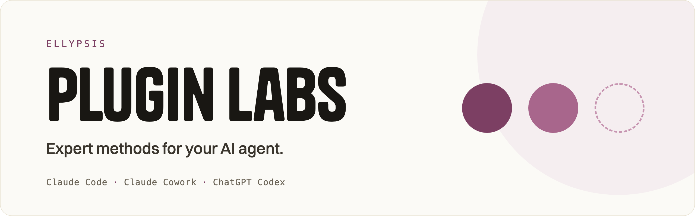

<p align="center">
  
</p>

<p align="center">
  
  
  
  
</p>

<p align="center">
  <a href="../README.md">English</a> ·
  <a href="README.da.md">Dansk</a> ·
  <a href="README.de.md">Deutsch</a> ·
  <a href="README.sv.md">Svenska</a> ·
  <a href="README.no.md">Norsk</a> ·
  <b>Français</b> ·
  <a href="README.es.md">Español</a>
</p>

---

Demandez un parcours d’inscription à votre agent IA, il vous en dessine un. Sans se demander qui s’inscrit, ce qui l’inquiète, ni pourquoi la moitié abandonne à l’étape deux. Il touche à tout, mais il n’est expert en rien.

**Plugin Labs lui apporte l’expertise.** Chaque plugin reprend la façon dont un spécialiste travaille vraiment : les questions qu’il pose en premier, les erreurs qu’il a appris à éviter, l’ordre dans lequel il avance. Installez-le une fois, il entre en jeu dès que vous demandez ce type de travail. Vous parlez à votre agent comme d’habitude. Sauf qu’il arrête de faire au pif.

## Au menu

| | Plugin | Ce qu’il fait pour vous | Fonctionne dans |
|:-:|---|---|---|
| 🧭 | **[ux-before-ui](../plugins/ux-before-ui)** | Réfléchit comme une équipe design avant de dessiner quoi que ce soit. Qui arrive, ce dont ils ont besoin, comment les meilleurs produits s’y prennent. Puis chaque écran côte à côte, passé à la critique et prêt pour le handoff. | Claude Code · Cowork · Codex |
| 🎞️ | **[not-ai-slop](../plugins/not-ai-slop)** | Transforme votre post en carrousel qui ne sent pas l’IA. Vous validez chaque mot d’abord, et les visuels suivent votre charte. | **Codex** (images intégrées) · Claude Code · Cowork |
| 🔬 | **[mcp-eval](../plugins/mcp-eval)** | Vérifie si Claude sait vraiment se servir de votre serveur MCP, et vous donne un verdict sans détour : prêt à livrer, ou pas. | Claude Code |

D’autres arrivent. Ajoutez la marketplace une fois, et les nouveaux plugins apparaissent tout seuls.

## Prêt en deux minutes

**Claude Code**

```
/plugin marketplace add EllypsisAI/ellypsis-plugin-labs
/plugin install ux-before-ui@ellypsis-labs
```

**Claude Cowork** (l’app de bureau Claude)

Customize → Browse plugins → Personal → **+** → Add marketplace from GitHub → collez `EllypsisAI/ellypsis-plugin-labs` → installez ce qui vous plaît.

**ChatGPT Codex** (app ou CLI)

```
codex plugin marketplace add EllypsisAI/ellypsis-plugin-labs
codex plugin add not-ai-slop@ellypsis-labs
```

**Ou ne vous fatiguez pas.** Collez ceci dans Claude Code ou Codex et laissez-le s’en charger :

> Ajoute la marketplace de plugins qui se trouve sur github.com/EllypsisAI/ellypsis-plugin-labs, puis installe ux-before-ui.

Ensuite, demandez simplement ce que vous voulez, avec vos mots. Le bon plugin prend le relais. Vous pouvez aussi en appeler un par son nom, comme `/ux-before-ui`.

## Pourquoi c’est mieux qu’un bon prompt

Un prompt dit à votre agent ce que vous voulez. Un plugin lui apprend comment un expert s’y prendrait, et ça, ça ne tient pas dans une fenêtre de chat.

- **Du jugement, pas des checklists.** Votre agent adapte la méthode à votre cas au lieu de remplir un modèle.
- **Vous gardez la main.** Les plans, le texte des slides et tout ce qui touche au monde réel attendent votre feu vert.
- **Zéro fait inventé.** S’il ne sait pas, il le dit.

## Qui est derrière tout ça ?

Nous sommes [Ellypsis](https://ellypsis.dk), un petit studio IA danois. Nous créons des plugins experts pour les équipes qui travaillent avec l’IA au quotidien. Cette marketplace, c’est la partie ouverte à tous, gratuite et sous licence MIT.

Un bug, une idée ? Ouvrez une issue et indiquez le plugin dans le titre.
